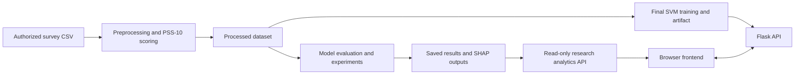

# A Comparative Explainable AI Framework for Stress Prediction

**Research title:** *A Comparative Explainable AI Framework for Stress Prediction Using Behavioral, Lifestyle, and Social Media Analytics Among Sri Lankan University Students*

[](https://www.python.org/)
[](https://flask.palletsprojects.com/)
[](https://scikit-learn.org/)
[](https://xgboost.readthedocs.io/)
[](https://shap.readthedocs.io/)
[](#academic-and-research-disclaimer)

This repository contains a research pipeline and local web prototype for classifying PSS-10-derived stress categories from behavioral, lifestyle, academic, demographic, and social media survey variables. It compares four machine-learning models, evaluates class-imbalance strategies, and provides model-attribution analyses and an interactive Flask application.

The study uses 1,500 responses from Sri Lankan university students. The repository does not include participant-level raw or processed data. Model evaluation results below refer to saved research experiments; they are distinct from the predictions produced for individual inputs by the web application.

> **Research use only.** This prototype is not a medical diagnostic system, does not provide clinical advice, and has not been externally validated. SHAP explains model behavior; its attributions do not establish causal relationships.

## Research overview

The target, `Stress_Level`, is constructed from PSS-10 responses. Predictors are 13 non-PSS fields covering demographic, academic, behavioral, lifestyle, and social media information. The experiments compare Logistic Regression, Support Vector Machine (SVM), Random Forest, and XGBoost using stratified holdout and cross-validation procedures. Separate imbalance-aware and nested cross-validation experiments are retained under `results/`.

## Research objectives

- Develop a reproducible preprocessing and evaluation pipeline for PSS-10-derived three-class stress prediction.
- Compare baseline classifiers using class-sensitive metrics as well as conventional summary measures.
- Assess imbalance-aware alternatives and feature-group ablations without using validation data for training-time transformations.
- Examine model-attributed influential features with SHAP.
- Demonstrate a local web interface and REST API while keeping the research evaluation distinct from deployed inference.

## Key features

- PSS-10 scoring and target construction from the raw survey input.
- Pipeline-based imputation, scaling, and categorical encoding.
- Four-model baseline comparison, stratified 10-fold CV, nested 5×5 CV, and additional imbalance experiments.
- SHAP global feature importance and local explanation outputs.
- Flask REST API with schema-driven validation, prediction probabilities, input-support notes, and runtime explanations.
- Browser interface for prediction and read-only research analytics.
- Saved experiment summaries, tables, plots, and metadata under `results/`.

## Dataset and data collection

The implemented source path is `dataset/raw/Stress Prediction Form.csv`. It represents 1,500 student responses and 25 original columns. The raw data file is not included in this public repository; `dataset/raw/` and `dataset/processed/` contain placeholders only. Reproduction requires an authorized local copy of the source CSV at the documented path. The current preprocessing implementation reports no missing values or exact duplicate rows in the inspected source. No additional recruitment, sampling-frame, response-rate, or provenance claims are made here because those details are not established by the repository.

Participant-level source data and derived records should not be committed or otherwise made public without appropriate authorization and privacy review. Generated aggregate results may still carry disclosure risks and should be reviewed before publication.

## PSS-10 scoring and target construction

The preprocessing script reverse-scores `PSS_Q4`, `PSS_Q5`, `PSS_Q7`, and `PSS_Q8` as `4 - response`; the remaining six responses are retained. It sums the scored items into `PSS10_Total` (possible range 0–40) and assigns the implemented operational categories:

| PSS-10 total | Target class |
|---:|---|
| 0–13 | Low Stress |
| 14–26 | Moderate Stress |
| 27–40 | High Stress |

These are the project’s implemented thresholds. The repository does not establish that they are clinically validated cutoffs for this population. Processed data retains the original questionnaire items along with the score and class.

## Input features and leakage prevention

The 13 predictors are `Age`, `Gender`, `University`, `Degree_Program`, `Academic_Year`, `Sleep_Hours`, `Exercise_Frequency`, `Screen_Time_Hours`, `Social_Media_Hours`, `Study_Hours`, `Academic_Pressure`, `Financial_Stress`, and `Family_Support`.

`PSS_Q1`–`PSS_Q10` and `PSS10_Total` are excluded from model predictors because they are used to construct the target; including them would leak target information. `Stress_Level` is the target, while `Timestamp` and `Consent` are excluded administrative fields.

## Stress class distribution

| Class | Responses | Share |
|---|---:|---:|
| Low Stress | 96 | 6.4% |
| Moderate Stress | 1,306 | 87.1% |
| High Stress | 98 | 6.5% |
| **Total** | **1,500** | **100%** |

The strong majority-class skew means accuracy alone can give a misleading picture of performance. Macro F1 gives equal weight to each class’s F1 score, and Balanced Accuracy averages recall across classes; both help expose weak minority-class performance.

## Machine-learning models

The baseline and nested comparison include:

- Logistic Regression
- Support Vector Machine (SVM)
- Random Forest
- XGBoost

The application’s selected model is an RBF SVM with `C=2.0`, `gamma="scale"`, and `class_weight="balanced"`. In the nested experiment, candidate selection uses mean inner Macro F1, then Balanced Accuracy as a tie-breaker. Across the outer-fold means, SVM had the highest Macro F1 among the four evaluated candidates. This is an exploratory selection within this dataset and candidate set, not a claim of general superiority.

## Preprocessing methodology

The shared scikit-learn pipeline uses median imputation for numeric fields, most-frequent imputation for categorical fields, and one-hot encoding for categorical predictors. Numeric predictors are scaled for Logistic Regression and SVM. The transformations are fitted within each training partition/fold to reduce preprocessing leakage. Exact duplicate rows are removed by the preprocessing script; no blanket outlier-removal procedure is applied.

## Model evaluation methodology

The repository contains distinct evaluation protocols; their scores should not be conflated:

| Protocol | Implementation |
|---|---|
| Baseline holdout | Stratified 80/20 split, random state 42, shared across models |
| Baseline cross-validation | Stratified 10-fold CV, shuffled, random state 42 |
| Nested cross-validation | Stratified 5-fold outer and 5-fold inner loops, shuffled, random state 42 |
| Imbalance-aware experiments | Separate experiments and saved outputs under `results/imbalance_aware/`, `results/imbalance_improved/`, and `results/three_class_improvement/` |

Within nested CV, hyperparameters are selected using only each outer training partition. Each inner candidate is scored by mean Macro F1, with mean Balanced Accuracy as a tie-breaker; preprocessing is refit within each training fold. Each selected pipeline is then evaluated on its held-out outer fold. The nested results are internal estimates on the same study dataset, not independent external validation. Five outer-fold standard deviations are descriptive; no conventional fold-based confidence intervals are claimed.

## Nested 5×5 stratified cross-validation: main results

The table reports mean ± standard deviation across the five outer folds. These are research evaluation estimates, not training scores or application-user confidence values.

| Model | Macro F1 | Balanced Accuracy |
|---|---:|---:|
| Logistic Regression | 0.2473 ± 0.0333 | **0.3578 ± 0.0625** |
| SVM | **0.3425 ± 0.0215** | 0.3451 ± 0.0242 |
| Random Forest | 0.3102 ± 0.0004 | 0.3331 ± 0.0006 |
| XGBoost | 0.3136 ± 0.0255 | 0.3192 ± 0.0260 |

SVM was selected primarily by Macro F1, with Balanced Accuracy as the tie-breaker. Logistic Regression had the highest mean Balanced Accuracy in this comparison. The different rankings illustrate why both metrics and per-class results matter under imbalance.

### Evaluation metrics

The nested experiment reports Accuracy, Balanced Accuracy, Macro Precision, Macro Recall, Macro F1, Weighted F1, and macro and weighted one-vs-rest ROC-AUC. It also saves per-class precision, recall, and F1, confusion matrices, and fold-level results. Macro F1 and Balanced Accuracy are emphasized because the minority classes account for only about 13% of the sample combined.

## Class imbalance and imbalance-aware experiments

The majority-class-only reference achieves 87.0% test accuracy but only 0.3333 Balanced Accuracy and 0.3102 Macro F1, demonstrating why accuracy is insufficient here. Low and High Stress each have fewer than 100 observations.

The imbalance-aware experiment reports that the baseline already uses `class_weight="balanced"` for Logistic Regression, SVM, and Random Forest; XGBoost receives training-partition-derived sample weights. It did not improve the selected SVM’s held-out Macro F1 over the baseline (both 0.3244) or held-out Balanced Accuracy (both 0.3299). Other saved experiments explore feature-group ablations, alternative class weighting, resampling, and threshold selection. Their summaries report that the evaluated alternatives did not pass the project’s conservative model-change gate; the application model was not changed. Consult the individual experiment summaries and metadata for full protocols and results.

## SHAP explainable AI

The baseline analysis supports model-specific explainers, including Kernel SHAP for SVM. The saved imbalance-aware SHAP analysis uses KernelExplainer for the SVM, with a 30-row training-only background sample and a 30-row explained sample. The API also computes approximate Kernel SHAP contributions at request time using a saved training-only background artifact. SHAP values describe how the fitted model attributes contributions to its output; they do not establish that an input feature causes stress.

### Top SHAP features

The saved global feature-importance output ranks the following original numeric fields highest in the recorded analysis:

| Rank | Feature | Mean absolute SHAP value |
|---:|---|---:|
| 1 | Sleep Hours | 0.004060 |
| 2 | Academic Pressure | 0.003754 |
| 3 | Social Media Hours | 0.002441 |
| 4 | Exercise Frequency | 0.001753 |
| 5 | Financial Stress | 0.001616 |

These are model-attributed influential features in this analysis, not causal factors. The exact feature importance is specific to the saved model, sample, and explanation procedure.

## System architecture



Research evaluation scripts create the saved outputs. The web application loads the exported inference pipeline and reads the existing analytics outputs; prediction requests do not retrain models, and the analytics view does not recalculate experiment metrics.

## Project structure

```text
.
├── application/
│   ├── artifacts/             # Model metadata; model binaries may be local/generated
│   ├── services/              # Prediction validation and explanation services
│   ├── API_DOCUMENTATION.md
│   ├── app.py                  # Flask API and static frontend server
│   └── train_final_model.py    # Exports the final SVM pipeline
├── dataset/
│   ├── raw/                    # Authorized local source CSV (not included)
│   └── processed/              # Generated processed data (not included)
├── experiments/                # Nested CV and imbalance-aware experiments
├── explainability/             # Offline SHAP analysis
├── frontend/                   # Vanilla HTML, CSS, and JavaScript interface
├── models/                     # Baseline model definitions and evaluator
├── preprocessing/               # Data preparation and PSS-10 target construction
├── research_paper/              # Manuscript, references, tables, and consistency notes
├── results/                     # Frozen metrics, summaries, figures, and explanation outputs
├── tests/                       # Python and JavaScript test suites
├── requirements.txt             # Pinned Python dependencies
└── README.md
```

## Web application features

The vanilla HTML/CSS/JavaScript frontend is served by Flask. It provides a prediction form, class probabilities, input-quality notes, approximate SHAP explanation, and a Research Analytics page that displays available saved research results. Input controls are populated from the API schema. A synthetic example uses training-set medians and modes rather than returning a participant row. Inputs are kept in page memory while open and are sent to the API only when prediction or explanation is requested; the frontend does not save them in browser storage. The API validates inputs against the exported schema and observed training domains.

The application loads a saved SVM pipeline once when the server starts. It serves research estimates as metadata but does not calculate those evaluation scores from the submitted profile. The displayed probabilities are model outputs, not measures of clinical certainty or calibrated individual risk.

## REST API endpoints

| Method | Path | Purpose |
|---|---|---|
| `GET` | `/api/health` | Reports whether the model pipeline loaded |
| `GET` | `/api/input-schema` | Returns feature names, observed ranges, distributions, and categories |
| `GET` | `/api/example-input` | Returns a synthetic median/mode feature-only example |
| `GET` | `/api/reference-profile` | Returns an aggregate median/mode reference profile and its prediction |
| `POST` | `/api/predict` | Validates an input profile and returns predicted class, probabilities, and input-quality note |
| `POST` | `/api/explain` | Returns prediction and approximate SHAP contributions for the predicted class |
| `GET` | `/api/model-info` | Returns model metadata and nested-CV estimates |
| `GET` | `/api/research-analytics` | Reads available saved metrics and SHAP/ablation outputs without retraining |

The API accepts JSON requests with the 13 predictor fields. It rejects missing or extra fields, PSS-derived inputs, invalid or out-of-domain values, and unseen categories. Requests are limited to 16 KB. See [`application/API_DOCUMENTATION.md`](application/API_DOCUMENTATION.md) for request and response details.

## Installation

Use CPython 3.12, as specified by `.python-version`. From the repository root in Windows PowerShell:

```powershell
py -3.12 -m venv .venv
.venv\Scripts\Activate.ps1
python -m pip install --upgrade pip
python -m pip install -r requirements.txt
python --version
```

Place an authorized copy of `Stress Prediction Form.csv` at `dataset/raw/Stress Prediction Form.csv` before running data-dependent commands. Do not add participant-level files to version control.

## Running the research pipeline

From the activated environment and repository root:

```powershell
python preprocessing/preprocess.py
python -m models.train_evaluate
python -m explainability.shap_analysis
```

The separate experiments are:

```powershell
python -m experiments.nested_stratified_cv
python -m experiments.imbalance_aware_research
python -m experiments.improved_imbalance_cv
python -m experiments.three_class_improvement
```

Preprocessing creates `dataset/processed/cleaned_stress_dataset.csv` and class-distribution outputs. Evaluation scripts write metrics and figures under `results/`; SHAP analysis writes under `results/shap_plots/`. Experiment-specific outputs are stored in their corresponding `results/` subdirectories.

**Preserve the frozen research artifacts.** These commands write result files and may overwrite files at their designated output paths. To reproduce or extend an experiment, use a separate working copy or back up the existing `results/` first; do not overwrite or replace archived outputs without an intentional, reviewed research decision. Application model training also writes files under `application/artifacts/`.

## Running the Flask backend and frontend

The API requires the exported files in `application/artifacts/`, including `final_svm_pipeline.joblib` and `shap_background.joblib`. If these are not available in the checkout, train/export the model from the authorized processed dataset:

```powershell
python application/train_final_model.py
```

This writes the inference pipeline, model metadata, and SHAP background into `application/artifacts/`. Then start the local Flask development server:

```powershell
python application/app.py
```

Open <http://127.0.0.1:5000/> for prediction or <http://127.0.0.1:5000/analytics> for saved research analytics. Flask serves both pages and their static assets, so a separate frontend server is not required. The server binds to localhost and is intended for local research use, not production deployment. Model files may be omitted from a checkout; verify `application/artifacts/` before launch.

## Testing

Run the repository’s current test suites from the root:

```powershell
python -m unittest discover -s tests
node --test tests/*.test.js
```

The Python suite requires the project environment and relevant local model/data artifacts where tests expect them. JavaScript tests require Node.js. These commands are documented from the existing test files; this README update did not run them.

## Reproducing and preserving the research

The repository records Python and dependency versions and uses random state 42 for the documented principal evaluation protocols. Reproduction also requires the authorized source CSV, the pinned environment, and sufficient compute time, particularly for nested CV and SHAP. Compare regenerated outputs with saved metadata and summaries rather than treating different protocol results as directly interchangeable.

Existing outputs under `results/` are archived research artifacts. New experiments should be run in an isolated copy or with a distinct output location, where supported. Preserve original outputs and record protocol, environment, and data provenance for any new run. Do not silently replace frozen metrics, figures, or explanation files.

## Data privacy and ethical considerations

This repository does not contain the participant-level raw or processed dataset. Obtain data through authorized channels and follow the data owner’s access conditions, institutional requirements, and applicable privacy rules. Do not publish or commit raw survey responses, processed participant-level records, or artifacts that could disclose individuals. Review aggregate outputs for disclosure risk before sharing.

The repository does not provide enough information to assert a specific ethics approval, exemption, recruitment procedure, consent protocol, or public data-sharing permission. These details should be supplied and verified by the research authors before formal publication or external data release. Avoid using the prototype to make decisions about individuals.

## Limitations

- The sample is limited to 1,500 collected responses; external validation on other universities or populations is not reported.
- Moderate Stress comprises 87.1% of the data, while Low and High Stress have 96 and 98 cases. Minority-class predictions and scores should be interpreted cautiously.
- In the nested-CV results, SVM minority-class recall is low (Low: 0.0937 ± 0.1078; High: 0.0711 ± 0.0264), despite its leading Macro F1 among the compared models.
- Five outer folds provide limited information about variability; fold standard deviations are descriptive and are not confidence intervals.
- The PSS category thresholds are implementation choices whose validity for this study population is not established in the repository.
- Application input validation is restricted to observed categories and numeric ranges. Input-quality annotations are descriptive support checks, not confidence or accuracy estimates.
- Approximate SHAP explanations depend on the fitted model, background sample, and method; they do not imply causation.
- The API uses Flask’s local development server and is not configured as a production service.

## Future work

Potential next steps, subject to research approval and data availability, include external validation across institutions, improved minority-class measurement and evaluation, prospective data collection, additional sensitivity analyses for the target thresholds, and user/privacy evaluation of the prototype. These are proposed directions, not completed repository features.

## Research paper

The repository includes a manuscript package in [`research_paper/`](research_paper/research_paper.md), together with references, tables, figures notes, and a consistency review. The consistency review identifies author-supplied details still needed for publication, including dataset provenance, ethics and consent information, threshold justification, and author declarations. The package is for author review and should not be described as submission-ready.

## Technologies used

| Area | Technologies verified in the repository |
|---|---|
| Language/runtime | Python 3.12 |
| Data processing | pandas, NumPy |
| Machine learning | scikit-learn, XGBoost, imbalanced-learn |
| Explainable AI | SHAP |
| Visualization | Matplotlib, Seaborn |
| API | Flask, Werkzeug |
| Frontend | HTML, CSS, vanilla JavaScript |
| Tests | Python `unittest`, Node.js built-in test runner |

Exact Python package versions are pinned in [`requirements.txt`](requirements.txt).

## Citation

No preferred citation metadata (such as a DOI, publication, or complete author list) is available in the repository. Until the authors provide it, cite the repository using its title and URL and include the access date. Do not invent authorship or publication details.

## Authors

Author names and affiliations are not specified in the repository. Add verified author and institutional information here before public academic release.

## Academic and research disclaimer

This project is an undergraduate research prototype for experimental and educational use. It is not a medical device, screening instrument, diagnosis, or substitute for assessment by a qualified professional. Predictions and probabilities are generated by a model trained on a limited, imbalanced dataset and may be wrong, especially for minority classes. SHAP explanations describe model attributions and do not identify causes. No clinical validity, individual-level reliability, or generalization beyond the evaluated sample is established.


